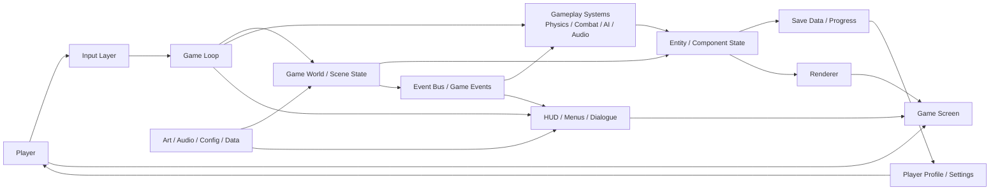

# Architecture Overview

This document captures the overall structure of the game we made for the Hassu project. The design keeps the game loop, world state, rendering, UI, and persistence logically separated so the project stays manageable as features grow.

## Core responsibilities

- Input Layer: captures player interaction from keyboard, mouse, or controller.
- Game Loop: runs update and render cycles for the application.
- Game World / Scene State: stores the active level, entities, and runtime environment.
- Gameplay Systems: manages logic like movement, collisions, AI, combat, and sound.
- UI Layer: handles menus, HUD, dialogues, notifications, and overlays.
- Assets: contains visual, audio, configuration, and data resources.
- Save Data / Progress: stores progression, checkpoints, settings, and saved game state.
- Renderer: turns the current world state into the image shown to the player.

## Design intent

This architecture keeps the project simple and readable by separating the responsibilities of simulation, presentation, and persistence. That makes it easier to add new systems or expand the game without tightly coupling unrelated parts of the code.
